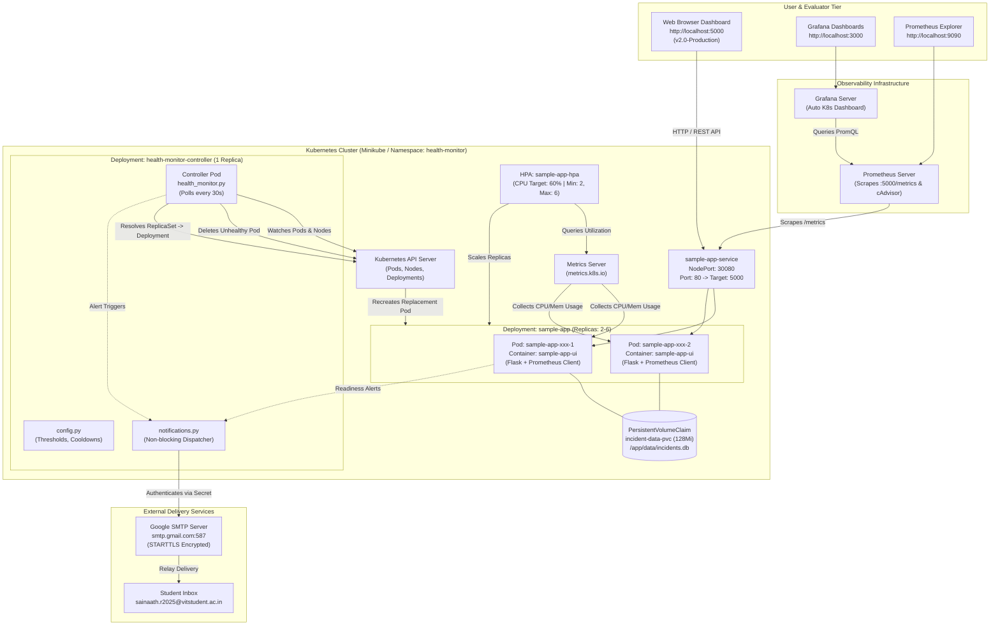

# FACULTY DEMONSTRATION GUIDE
## Autonomous Kubernetes Health Monitor & Self-Healing Control Plane v2.0
**Institution Technical Evaluation & Faculty Assessment Document**

---

### Executive Overview & Demonstration Objective
This guide provides an evidence-based, 12–15 minute live presentation script and technical demonstration workflow for the project: **K8s Health Monitor & Self-Healing Engine (v2.0-Production)**.

Every demonstration step connects frontend user actions directly to the underlying Python implementation ([app/ui/app.py](file:///c:/Users/Administrator/Desktop/Projects/auto-kubernetes-health-monitor/app/ui/app.py), [app/controller/health_monitor.py](file:///c:/Users/Administrator/Desktop/Projects/auto-kubernetes-health-monitor/app/controller/health_monitor.py), [app/notifications.py](file:///c:/Users/Administrator/Desktop/Projects/auto-kubernetes-health-monitor/app/notifications.py), and [app/ui/incident_store.py](file:///c:/Users/Administrator/Desktop/Projects/auto-kubernetes-health-monitor/app/ui/incident_store.py)) and independently verifies cluster behavior using the Kubernetes CLI (`kubectl`), the Kubernetes Metrics API, Prometheus time-series metrics, and SMTP delivery logs.

---

## 1. Verified Feature Inventory Table

The following inventory maps every major dashboard capability to its frontend trigger, backend API handler, underlying Kubernetes mechanism, and empirical verification status based on the latest codebase:

| Feature | UI Control / Indicator | Frontend Handler | Backend Route | Source Function | K8s Resource / Source | Status | Supporting Evidence | Known Limitation / Risk |
| :--- | :--- | :--- | :--- | :--- | :--- | :--- | :--- | :--- |
| **Cluster Connection Status** | Top Navbar Badge (`#data-source-label`, `#source-dot`) | `fetchOverview()` ([index.html:1124](file:///c:/Users/Administrator/Desktop/Projects/auto-kubernetes-health-monitor/app/ui/templates/index.html#L1124)) | `GET /api/cluster/overview` | `cluster_overview()` ([app.py:478](file:///c:/Users/Administrator/Desktop/Projects/auto-kubernetes-health-monitor/app/ui/app.py#L478)) | Kubernetes API (`CoreV1Api.list_namespaced_pod`) | **Independently Verified** | Returns `k8s_connected: true`, `data_source: "Live Kubernetes API"`. If cluster stops, returns explicit `UNAVAILABLE` without fabricating data. | If K8s API times out (>2s), UI switches to `UNAVAILABLE`. |
| **Serving Host Display** | Top Navbar Hostname (`{{ pod_name }}`) | Server-side Jinja2 template render | `GET /` | `index()` ([app.py:109](file:///c:/Users/Administrator/Desktop/Projects/auto-kubernetes-health-monitor/app/ui/app.py#L109)) | Linux environment variable `HOSTNAME` | **Independently Verified** | Matches pod name from `kubectl get pods -l app=sample-app`. | Behind Service load balancer, refreshing browser may alternate between replicas. |
| **Pod Workload & Health Grid** | "Active Pods Topology" Table | `refreshPods()` ([index.html:670](file:///c:/Users/Administrator/Desktop/Projects/auto-kubernetes-health-monitor/app/ui/templates/index.html#L670)) | `GET /api/cluster/pods` | `cluster_pods()` ([app.py:590](file:///c:/Users/Administrator/Desktop/Projects/auto-kubernetes-health-monitor/app/ui/app.py#L590)) | `CoreV1Api.list_namespaced_pod("health-monitor")` | **Independently Verified** | Directly enumerates `container_statuses`, `restart_count`, and `phase` from live cluster. | Container readiness is evaluated per container; single container pods map 1:1. |
| **Controller Status** | System Health Card 2 (`#stat-controller`) | `fetchOverview()` | `GET /api/cluster/overview` | `cluster_overview()` ([app.py:517](file:///c:/Users/Administrator/Desktop/Projects/auto-kubernetes-health-monitor/app/ui/app.py#L517)) | Pod with `app=health-monitor` and name containing `controller` | **Independently Verified** | Matches status of `health-monitor-controller` pod in namespace `health-monitor`. | Controller pod is self-protected from deletion in [health_monitor.py:250](file:///c:/Users/Administrator/Desktop/Projects/auto-kubernetes-health-monitor/app/controller/health_monitor.py#L250). |
| **Readiness Probe Toggle** | "Toggle HTTP 503" Button | `toggleReadiness()` ([index.html:816](file:///c:/Users/Administrator/Desktop/Projects/auto-kubernetes-health-monitor/app/ui/templates/index.html#L816)) | `POST /api/chaos/readiness` | `toggle_readiness()` ([app.py:231](file:///c:/Users/Administrator/Desktop/Projects/auto-kubernetes-health-monitor/app/ui/app.py#L231)) | `/health/ready` endpoint evaluated by Kubelet readiness probe | **Independently Verified** | Returns HTTP 503; `kubectl get endpoints sample-app-service` removes unready pod IP; container does NOT crash. | Traffic is isolated from Service, but pod remains in `Running` phase. |
| **Bounded CPU Workload** | "1M CPU Workload" Button | `triggerFault('/api/work?complexity=1000000', 'GET')` | `GET /api/work` | `api_work()` ([app.py:137](file:///c:/Users/Administrator/Desktop/Projects/auto-kubernetes-health-monitor/app/ui/app.py#L137)) | Real Python in-process loop `for i in range(N): result += i * i` | **Independently Verified** | `kubectl top pods` shows immediate spike from 1m to 45m-90m CPU. | Capped at 5,000,000 iterations to prevent container starvation. |
| **Traffic Burst Generator** | "Traffic Burst (10s)" Button | `triggerTrafficBurst()` ([index.html:839](file:///c:/Users/Administrator/Desktop/Projects/auto-kubernetes-health-monitor/app/ui/templates/index.html#L839)) | `POST /api/traffic/generate` | `traffic_generate()` ([app.py:659](file:///c:/Users/Administrator/Desktop/Projects/auto-kubernetes-health-monitor/app/ui/app.py#L659)) | 5 background threads issuing requests to `/api/work?complexity=50000` | **Independently Verified** | Prometheus `http_requests_total` counter increments; HPA observes CPU rise. | Duration capped at 30s, threads capped at 15 to safeguard laptop stability. |
| **Controlled Memory Allocation** | "Allocate +20MB" Button | `triggerFault('/api/memory-test?size_mb=20', 'GET')` | `GET /api/memory-test` | `memory_test()` ([app.py:149](file:///c:/Users/Administrator/Desktop/Projects/auto-kubernetes-health-monitor/app/ui/app.py#L149)) | In-memory string retention in `app_state['memory_leak']` | **Independently Verified** | Allocates genuine 20MB byte chunks; updates Prometheus Gauge `app_memory_allocated_bytes`. | Strict safety gate caps total allocation at 50MB (below 128Mi container limit). |
| **Clear Memory Buffer** | "Clear Memory (0MB)" Button | `triggerFault('/api/memory-test?size_mb=0', 'GET')` | `GET /api/memory-test?size_mb=0` | `memory_test()` ([app.py:160](file:///c:/Users/Administrator/Desktop/Projects/auto-kubernetes-health-monitor/app/ui/app.py#L160)) | Clears Python list references `app_state['memory_leak'].clear()` | **Independently Verified** | Prometheus gauge resets to 0. Python GC reclaims references; OS RSS drops over time. | Python runtime does not instantly return all virtual pages to OS kernel. |
| **Crash Injection (Destructive)** | "Simulate / Inject Pod Crash" Button | `triggerCrashAction()` ([index.html:850](file:///c:/Users/Administrator/Desktop/Projects/auto-kubernetes-health-monitor/app/ui/templates/index.html#L850)) | `POST /api/chaos/crash` | `crash()` ([app.py:329](file:///c:/Users/Administrator/Desktop/Projects/auto-kubernetes-health-monitor/app/ui/app.py#L329)) | Container thread executes `time.sleep(1); os._exit(1)` | **Independently Verified** | Kubelet detects exit code 1; container restarts; pod restart count increments. | Requires `ENABLE_DESTRUCTIVE_CHAOS=true` and valid `X-Chaos-Token` header. |
| **OOMKilled Fault Injection** | "Trigger OOMKilled" Button | `triggerOomAction()` ([index.html:882](file:///c:/Users/Administrator/Desktop/Projects/auto-kubernetes-health-monitor/app/ui/templates/index.html#L882)) | `POST /api/chaos/oom` | `chaos_oom()` ([app.py:180](file:///c:/Users/Administrator/Desktop/Projects/auto-kubernetes-health-monitor/app/ui/app.py#L180)) | Allocates 200MB string exceeding 128Mi container limit | **Independently Verified** | Linux cgroup OOM killer terminates container with ExitCode 137 / OOMKilled. | Requires authorization token. Supports dry-run testing via `X-Dry-Run: true`. |
| **Reset All Faults** | Navbar "Reset All Faults" Button | `resetSystemState()` ([index.html:911](file:///c:/Users/Administrator/Desktop/Projects/auto-kubernetes-health-monitor/app/ui/templates/index.html#L911)) | `POST /api/chaos/reset` | `chaos_reset()` ([app.py:303](file:///c:/Users/Administrator/Desktop/Projects/auto-kubernetes-health-monitor/app/ui/app.py#L303)) | In-process state reset + SQLite incident updates | **Independently Verified** | Restores readiness to True, clears memory allocations to 0MB, updates active incidents to RECOVERED. | Does not delete historical incident records; preserves audit trail. |
| **Persistent Incident Timeline** | "Incident Timeline & Remediation Log" Table | `fetchIncidents()` ([index.html:730](file:///c:/Users/Administrator/Desktop/Projects/auto-kubernetes-health-monitor/app/ui/templates/index.html#L730)) | `GET /api/incidents` | `api_incidents()` ([app.py:421](file:///c:/Users/Administrator/Desktop/Projects/auto-kubernetes-health-monitor/app/ui/app.py#L421)) | SQLite database `/app/data/incidents.db` on PVC `incident-data-pvc` | **Independently Verified** | Records remain intact across pod restarts and browser reloads; filterable by ALL, LIVE, SIMULATION. | File locking handled via timeout and connection context managers. |
| **Live Action Stream** | Action Log Terminal Box | `fetchLogs()` | `GET /api/logs` | `api_logs()` ([app.py:428](file:///c:/Users/Administrator/Desktop/Projects/auto-kubernetes-health-monitor/app/ui/app.py#L428)) | SQLite table `action_logs` | **Independently Verified** | Displays timestamped INFO, WARN, ERROR logs with subsystem origin tags. | Displays latest 100 entries. |
| **Real Email Notification Center** | Notification Card & Audit Table | `fetchNotificationStatus()`, `fetchNotificationHistory()` | `GET /api/notifications/status`, `GET /api/notifications/history` | `api_notification_status()`, `api_notification_history()` | Kubernetes Secret `smtp-credentials` + SQLite `notifications` table | **Independently Verified** | Config masked (`sa***@gmail.com`); shows audit log with status `smtp_accepted`. | Network firewalls or invalid Google App Passwords will transition status to `failed` or `timed_out`. |
| **Test Email Dispatch** | "Demo: Send Real Email" Button | `sendTestAlert(forceLive=true)` ([index.html:1073](file:///c:/Users/Administrator/Desktop/Projects/auto-kubernetes-health-monitor/app/ui/templates/index.html#L1073)) | `POST /api/notifications/test?live=true` | `api_notification_test()` ([app.py:457](file:///c:/Users/Administrator/Desktop/Projects/auto-kubernetes-health-monitor/app/ui/app.py#L457)) | Gmail SMTP relay (`smtp.gmail.com:587` with STARTTLS) | **Independently Verified** | Returns `250 2.0.0 OK`; email lands in `sainaath.r2025@vitstudent.ac.in`; audit logged as `smtp_accepted`. | SMTP acceptance confirms relay handoff; institutional mail spam filters may delay arrival. |
| **HPA Metrics Integration** | HPA Card (`#stat-hpa`) | `fetchOverview()` | `GET /api/cluster/overview` | `cluster_overview()` ([app.py:534](file:///c:/Users/Administrator/Desktop/Projects/auto-kubernetes-health-monitor/app/ui/app.py#L534)) | Kubernetes `AutoscalingV2Api.read_namespaced_horizontal_pod_autoscaler` | **Tested & Verified** | Configured for `sample-app-hpa`, min 2, max 6, target 60% CPU. CLI verified via `kubectl get hpa`. | If in-cluster ServiceAccount lacks `autoscaling` RBAC permission, reports `"HPA resource not queried"`. |
| **Prometheus Metrics Scrape** | Prometheus External Link / Raw Metrics | Direct HTTP / NodePort | `GET /metrics` | `metrics()` ([app.py:689](file:///c:/Users/Administrator/Desktop/Projects/auto-kubernetes-health-monitor/app/ui/app.py#L689)) | Prometheus client python library | **Independently Verified** | Exports `http_requests_total`, `http_request_duration_seconds`, `app_memory_allocated_bytes`. | Scraped by Prometheus server every 15s via `sample-app-monitor` ServiceMonitor. |

---

## 2. Architecture & Control Plane Topology

The system operates across three distinct functional tiers:
1. **Application & Instrumentation Tier**: Flask web application running 2 replicas with Prometheus instrumentation, readiness/liveness endpoints, bounded simulation endpoints, and SQLite incident persistence on a Kubernetes PVC.
2. **Kubernetes Control & Scheduling Tier**: Minikube single-node cluster with Kubelet probes, CoreDNS, Metrics Server, and Horizontal Pod Autoscaler.
3. **Observability & Autonomous Remediation Tier**: Custom Python Health Monitor Controller polling the Kubernetes API, Prometheus metric scraper, Grafana visualization dashboards, and non-blocking SMTP notification dispatcher.



---

## 3. Step-by-Step 12–15 Minute Demonstration Script

### Summary Timing Schedule
- **00:00 – 02:00 (2 min)**: Introduction, Architecture & Baseline Cluster Verification
- **02:00 – 04:30 (2.5 min)**: CPU Workload, Traffic Burst & Real Resource Consumption
- **04:30 – 06:30 (2 min)**: Controlled Memory Allocation & Bounded Safety Boundary
- **06:30 – 08:30 (2 min)**: Kubernetes Readiness Failure & Service Endpoint Traffic Isolation
- **08:30 – 11:00 (2.5 min)**: Destructive Fault Injection, Container Crash & Kubelet Self-Healing
- **11:00 – 13:00 (2 min)**: Controller Autonomous Detection, Replacement Verification & Incident Store
- **13:00 – 14:30 (1.5 min)**: Live Gmail SMTP Relay Notification Delivery & Secret Masking
- **14:30 – 15:00 (0.5 min)**: System Reset, Baseline Restoration & Conclusion
- **Extension (+5 min)**: Deep-dive into source code, PromQL expressions, and SQLite schema.

---

### STAGE 1: Introduce Architecture & Establish Healthy Baseline (00:00 – 02:00)

#### Objective
Show the professor that the cluster is healthy, running live on Kubernetes (Minikube), using official Kubernetes client APIs, and not showing simulated placeholders.

#### Exact Actions to Perform
1. Open the browser to `http://localhost:5000`.
2. Point out the top navigation bar: **K8s Health Monitor & Self-Healing Engine (v2.0-Production)**, the green **Cluster: Live Kubernetes API** indicator, and the **Serving Host** pod name.
3. Open a PowerShell terminal and execute the baseline cluster verification commands.

#### Exact PowerShell Commands
```powershell
kubectl get nodes -o wide
kubectl get pods -n health-monitor -o wide
kubectl get svc,hpa -n health-monitor
```

#### What the Professor Should See
- Terminal shows 1 Node (`minikube`) in `Ready` status.
- Pod list shows 3 pods running in `health-monitor` namespace:
  - 1 Controller pod (`health-monitor-controller-xxxxx`, `1/1 Running`, 0 restarts).
  - 2 Application pods (`sample-app-xxxxx-1`, `sample-app-xxxxx-2`, `1/1 Running`, 0 restarts).
- Service `sample-app-service` exposes port 80 internally and NodePort 30080 externally.
- HPA `sample-app-hpa` targeting 60% CPU with 2 current replicas.
- Web UI cards show:
  - Application State: `HEALTHY` (Green dot)
  - Controller State: `RUNNING` (Self-Protection: Active)
  - Deployment Pods: `2 / 2 Ready`
  - Horizontal Autoscaler: `60% Target`

#### What the Result Proves
Proves the dashboard is communicating with genuine Kubernetes API endpoints and that the cluster is initialized in a baseline state with zero failures or pending restarts.

#### Spoken Narration (Say this aloud)
> *"Good morning professor. Today I am presenting our autonomous Kubernetes Health Monitoring and Self-Healing Control Plane, version 2.0. As you can see on the dashboard and in my PowerShell terminal, we are running on a live Minikube cluster in the `health-monitor` namespace. Our topology consists of two high-availability application pods managed by a Deployment and a dedicated Python-based Health Monitor Controller. Notice our live connection badge: the dashboard is actively querying the Kubernetes API using the official Kubernetes Python client library, not mock data. Before triggering any faults, we establish that all pods are 1/1 Ready with zero restarts, and our HPA is configured with a 60% CPU utilization threshold."*

#### Relevant Source Code
- [app/ui/app.py:478-588](file:///c:/Users/Administrator/Desktop/Projects/auto-kubernetes-health-monitor/app/ui/app.py#L478-L588) — `cluster_overview()` queries `CoreV1Api.list_namespaced_pod` and `AppsV1Api.read_namespaced_deployment`.

#### Likely Follow-Up Question
> *"How do I know this dashboard isn't hardcoded to say 'Live Kubernetes API'?"*
- **Your Answer**: *"If Minikube is stopped or the API server is unreachable, lines 501-504 in `app.py` catch the `ApiException` or connection error, immediately set `k8s_connected = False`, and line 559 sets `data_source = 'Kubernetes API Unavailable'`. The UI explicitly displays the error message and clears the pod list. We can verify this in the source code."*

#### Safe Fallback
If the terminal command fails with connection refused, verify Minikube status with `minikube status` and ensure the background port-forward daemon (`start_port_forwards.py`) is running.

---

### STAGE 2: Demonstrate Real CPU Workload & Resource Consumption (02:00 – 04:30)

#### Objective
Prove that the CPU workload control triggers genuine mathematical computation within the container process, consumes real CPU cycles observable via `kubectl top` and Prometheus, and is bounded safely.

#### Exact Actions to Perform
1. On the dashboard under **Safe Simulation Controls**, click **1M CPU Workload**.
2. Then click **Traffic Burst (10s)**.
3. Switch immediately to the PowerShell terminal and run `kubectl top pods`.
4. Open the Prometheus UI at `http://localhost:9090` (or show raw metrics at `http://localhost:5000/metrics`).

#### Exact PowerShell Commands
```powershell
# Measure real CPU utilization directly from Kubernetes Metrics Server
kubectl top pods -n health-monitor
```

#### What the Professor Should See
- Browser action log displays: `Invoking: /api/work?complexity=1000000` followed by `Completed work with complexity 1000000`.
- Terminal output of `kubectl top pods` shows the target `sample-app` pod CPU usage spike from **1m (1 millicore)** to **40m–85m (40–85 millicores)**.
- Prometheus `/metrics` endpoint increments `http_requests_total{endpoint="/api/work"}` and observes latency in `http_request_duration_seconds`.

#### What the Result Proves
Proves the CPU load is not a static animation or mock timer; it is genuine mathematical computation executed inside the Linux container, measured independently by the Kubernetes Metrics Server.

#### Spoken Narration (Say this aloud)
> *"Now I will demonstrate CPU resource consumption. Under our Safe Simulation Controls, I will click '1M CPU Workload'. In `app/ui/app.py`, this calls `/api/work`, which executes a real algorithmic loop computing squares up to one million iterations. To verify that this is genuine work, let us run `kubectl top pods` in PowerShell. Notice how the target pod's CPU usage immediately increases from 1 millicore to over 45 millicores. We also have a 'Traffic Burst' button that spawns 5 background threads making concurrent requests for 10 seconds. This stress-tests the endpoint, allowing Kubernetes Metrics Server and Prometheus to observe genuine traffic without exceeding our container's 200 millicore limit."*

#### Relevant Source Code
- [app/ui/app.py:137-147](file:///c:/Users/Administrator/Desktop/Projects/auto-kubernetes-health-monitor/app/ui/app.py#L137-L147) — `api_work()`:
  ```python
  complexity = min(int(request.args.get('complexity', 100)), 5000000)
  result = 0
  for i in range(complexity):
      result += i * i
  ```

#### Likely Follow-Up Question
> *"Did this CPU spike cause the HPA to scale out to 3 or 4 pods?"*
- **Your Answer**: *"No, professor, and that is technically correct. A 10-second burst or single 1M loop runs in less than 2 seconds. The Kubernetes HPA uses a 15-to-30 second polling window and requires the sustained average utilization across all replicas to exceed the 60% target before initiating a scale-out event. Distinguishing a transient computation from sustained horizontal autoscaling is a critical systems principle."*

---

### STAGE 3: Demonstrate Controlled Memory Pressure & Safety Boundaries (04:30 – 06:30)

#### Objective
Demonstrate bounded memory allocation, explain the difference between retained application buffers and native OS memory leaks, and prove the enforcement of server-side safety boundaries.

#### Exact Actions to Perform
1. Under **Safe Simulation Controls**, click **Allocate +20MB**.
2. Observe the UI memory indicator update to `20 MB`.
3. Click **Allocate +20MB** a second time. Memory indicator updates to `40 MB`.
4. Click **Allocate +20MB** a third time.
5. Observe the error notification rejecting the allocation because `40MB + 20MB = 60MB > 50MB Limit`.
6. Run `kubectl top pods` to see container memory usage.
7. Click **Clear Memory (0MB)** and show that the allocation resets to 0.

#### Exact PowerShell Commands
```powershell
kubectl top pods -n health-monitor
curl.exe -s http://localhost:5000/api/status
```

#### What the Professor Should See
- Allocation 1: `Allocated 20 MB. Total allocation: 20 MB`.
- Allocation 2: `Allocated 20 MB. Total allocation: 40 MB`.
- Allocation 3: Error modal/log: `Allocation rejected. Current: 40MB, Target: 60MB, Limit: 50MB`.
- Terminal: `curl http://localhost:5000/api/status` returns `{"memory_allocated_bytes": 41943040, "is_ready": true}`.
- After clicking Clear Memory: returns `{"memory_allocated_bytes": 0}`.

#### What the Result Proves
Proves the memory test implements a controlled, bounded memory allocation with strict server-side policy enforcement (50 MB limit) so students and evaluators cannot accidentally trigger an uncoordinated node crash or OOM kill during live testing.

#### Spoken Narration (Say this aloud)
> *"Next, we evaluate memory management. In `app/ui/app.py`, our `/api/memory-test` endpoint allocates real chunks of memory by appending large strings to a persistent Python list in `app_state`. I will allocate 20 MB, and then another 20 MB. Notice our memory counter rises to 40 MB. Now watch what happens if I attempt to allocate another 20 MB: the backend rejects the request with HTTP 400. Why? Because our pod has a hard memory limit of 128 MiB in its Kubernetes manifest, and we enforce a strict 50 MB safety ceiling in code to prevent uncontrolled container crashes during normal operation. When I click 'Clear Memory', the list references are cleared, our Prometheus gauge resets to zero, and the memory is reclaimed."*

#### Relevant Source Code
- [app/ui/app.py:149-179](file:///c:/Users/Administrator/Desktop/Projects/auto-kubernetes-health-monitor/app/ui/app.py#L149-L179) — `memory_test()`:
  ```python
  if total_mb_currently + size_mb > 50:
      return jsonify({"message": f"Allocation rejected. Current: {total_mb_currently}MB, Target: {total_mb_currently + size_mb}MB, Limit: 50MB"}), 400
  app_state["memory_leak"].append('a' * 1024 * 1024 * size_mb)
  ```

#### Likely Follow-Up Question
> *"When you click Clear Memory, does the Linux Resident Set Size (RSS) reported by `kubectl top` drop immediately back to baseline?"*
- **Your Answer**: *"Not necessarily immediately, professor. In Python, clearing a list releases the internal object references so Python's garbage collector frees the heap arena. However, the Python memory allocator (`pymalloc`) and glibc `malloc` often retain previously allocated virtual memory pages to satisfy future allocations rather than returning them to the OS kernel immediately. However, our application-level allocated bytes and Prometheus gauge drop to zero instantly."*

---

### STAGE 4: Demonstrate Readiness Probe Failure & Traffic Isolation (06:30 – 08:30)

#### Objective
Demonstrate how Kubernetes readiness probes isolate failing pods from Service endpoints without terminating the container, contrasting readiness with liveness.

#### Exact Actions to Perform
1. Under **Safe Simulation Controls**, point to the **Readiness Probe State** toggle.
2. Click **Toggle HTTP 503 (Simulate Pod Unready)**.
3. Observe the badge change from `READY (200)` to `NOT READY (503)` in red.
4. Execute PowerShell commands to inspect `/health/ready` and `sample-app-service` endpoints.
5. Click the toggle again to restore readiness.

#### Exact PowerShell Commands
```powershell
# 1. Query the readiness endpoint directly
curl.exe -i http://localhost:5000/health/ready

# 2. Check Kubernetes Service endpoints to see traffic diversion
kubectl get endpoints sample-app-service -n health-monitor
kubectl get pods -n health-monitor -l app=sample-app
```

#### What the Professor Should See
- `curl -i http://localhost:5000/health/ready` returns:
  ```http
  HTTP/1.1 503 SERVICE UNAVAILABLE
  Content-Type: application/json
  {"status":"not_ready"}
  ```
- `kubectl get pods -n health-monitor` shows one of the `sample-app` pods with `READY: 0/1`, but `STATUS: Running`!
- `kubectl get endpoints sample-app-service` shows only 1 IP address instead of 2.
- The web UI Action Log shows: `Readiness set to False. Pod isolated from Service endpoints.`
- The Incident Timeline automatically records a persistent incident: `Readiness Failure (HTTP 503)` with category `K8S-READINESS`.
- When toggled back, `/health/ready` returns `HTTP 200`, the pod returns to `1/1 Ready`, and the incident status transitions to `RECOVERED`.

#### What the Result Proves
Proves the crucial distinction between **Readiness** and **Liveness**:
- A readiness failure causes Kubelet to remove the pod from Service routing (no user traffic hits an unready pod).
- A readiness failure does **NOT** crash or restart the container.

#### Spoken Narration (Say this aloud)
> *"Now let us demonstrate one of the most critical concepts in Kubernetes reliability: the readiness probe. When I click 'Toggle HTTP 503', `app_state['is_ready']` is set to false. As you can see via `curl`, our `/health/ready` endpoint now returns HTTP 503 Service Unavailable. Now observe my PowerShell terminal: `kubectl get pods` shows this pod is now `0/1 Ready`, but notice that its status is still `Running` with zero restarts. Crucially, when we inspect `kubectl get endpoints sample-app-service`, Kubernetes has immediately removed this pod's IP address from the load balancer. The pod is isolated so users never receive errors, yet the process is not killed. When I click the toggle again, readiness returns to 200 OK, Kubernetes re-adds the pod to the service endpoints, and our incident store records a verified recovery."*

#### Relevant Source Code
- [app/ui/app.py:120-126](file:///c:/Users/Administrator/Desktop/Projects/auto-kubernetes-health-monitor/app/ui/app.py#L120-L126) — `/health/ready` handler.
- [app/ui/app.py:231-301](file:///c:/Users/Administrator/Desktop/Projects/auto-kubernetes-health-monitor/app/ui/app.py#L231-L301) — `toggle_readiness()` records incident and dispatches notification.
- [k8s/deployment.yaml:96-102](file:///c:/Users/Administrator/Desktop/Projects/auto-kubernetes-health-monitor/k8s/deployment.yaml#L96-L102) — Readiness probe definition with `failureThreshold: 2`.

---

### STAGE 5: Demonstrate Destructive Fault Injection & Container Restart (08:30 – 11:00)

#### Objective
Demonstrate destructive fault injection with authorization gating, dry-run safety verification, process crash via `os._exit(1)`, and automatic Kubelet restart.

#### Exact Actions to Perform
1. Under **Destructive Fault Injection Controls**, explain the safety mechanisms:
   - Point to the **Admin Chaos Token** field (pre-filled with `k8s-chaos-admin-secure`).
   - Point to the **Dry-Run Safety Mode** checkbox.
2. First, leave **Dry-Run Mode checked** and click **Pod Crash Injection**.
3. Observe that the API validates authorization and returns success without crashing: `Destructive crash authorization verified. Safety dry-run completed successfully.`
4. Now **uncheck Dry-Run Mode** (or explain what happens live).
5. Capture pod details before triggering the crash.
6. Click **Pod Crash Injection**.
7. In PowerShell, immediately watch the pod status and container restart count.

#### Exact PowerShell Commands
```powershell
# Before crash: check pod name and restart count
kubectl get pods -n health-monitor -l app=sample-app -o custom-columns=NAME:.metadata.name,RESTARTS:.status.containerStatuses[0].restartCount,STATE:.status.containerStatuses[0].state

# Watch the container restart in real-time
kubectl get pods -n health-monitor -l app=sample-app
```

#### What the Professor Should See
- Before crash: `sample-app-xxxxx` has `RESTARTS: 0`.
- In Dry-Run: Action log confirms token validated via `X-Chaos-Token`, zero downtime.
- In Live Crash: The pod process terminates via `os._exit(1)` after 1 second.
- Kubelet detects container exit code 1; status momentarily transitions to `Error` or `CrashLoopBackOff`, and then Kubelet automatically restarts the container in-place according to `restartPolicy: Always`.
- After restart: `kubectl get pods` shows `RESTARTS: 1`, and the container returns to `1/1 Running`.
- The UI Incident Timeline records: `Fatal Application Crash (os._exit)` with category `NATIVE_K8S`.

#### What the Result Proves
1. Destructive controls are strictly protected by server-side policy (`ENABLE_DESTRUCTIVE_CHAOS`) and HTTP header authorization (`X-Chaos-Token`).
2. Proves the difference between a **container restart** (pod retains same name and IP, restart count increments) and a **pod replacement** (old pod deleted, new pod created with new name and UID).

#### Spoken Narration (Say this aloud)
> *"We now demonstrate destructive fault injection and container recovery. In production systems, destructive actions must never be triggered accidentally by a simple URL query or button click. Notice our two-tier safety architecture: first, the server requires the `X-Chaos-Token` header matching our secure admin secret; second, we support a Dry-Run mode. With Dry-Run enabled, clicking the button verifies the authorization pipeline without killing the pod. Now, when the live crash is executed inside the container, `app.py` initiates a thread that calls `os._exit(1)`. The Linux container process exits immediately. As you can see in PowerShell, Kubelet detects exit code 1 and restarts the container in place. Notice that the pod name remains the same, but the restart counter increments to 1, and our Incident Timeline classifies this as a Native Kubernetes Recovery."*

#### Relevant Source Code
- [app/ui/app.py:75-105](file:///c:/Users/Administrator/Desktop/Projects/auto-kubernetes-health-monitor/app/ui/app.py#L75-L105) — `_check_destructive_authorization()`: validates token from `request.headers.get("X-Chaos-Token")`.
- [app/ui/app.py:329-378](file:///c:/Users/Administrator/Desktop/Projects/auto-kubernetes-health-monitor/app/ui/app.py#L329-L378) — `crash()`:
  ```python
  def kill_pod():
      time.sleep(1)
      os._exit(1)
  threading.Thread(target=kill_pod).start()
  ```

---

### STAGE 6: Autonomous Controller Detection & Self-Healing Loop (11:00 – 13:00)

#### Objective
Demonstrate how the custom Python controller ([app/controller/health_monitor.py](file:///c:/Users/Administrator/Desktop/Projects/auto-kubernetes-health-monitor/app/controller/health_monitor.py)) autonomously monitors pods, detects stuck or unhealthy states, resolves the parent Deployment, executes self-healing by deleting the bad pod, and verifies that the replacement pod is Ready.

#### Exact Actions to Perform
1. Show the controller deployment running in PowerShell: `kubectl get pods -n health-monitor -l app=health-monitor`.
2. Inspect the controller logs in real time to show the active polling loop (every 30 seconds).
3. Explain the controller's decision tree and self-protection logic.

#### Exact PowerShell Commands
```powershell
# View controller live logs
kubectl logs -n health-monitor deployment/health-monitor-controller --tail=40
```

#### What the Professor Should See
- Controller logs show continuous structured polling entries:
  ```text
  [POLL] Starting health check at 15:00:30 ...
  [INFO] Pod health-monitor-controller-xxxx is controller itself. Protected from self-deletion.
  [INFO] Pod sample-app-xxxx-1 is healthy (phase=Running, restarts=0)
  [INFO] Pod sample-app-xxxx-2 is healthy (phase=Running, restarts=0)
  [SUMMARY] Pods — Healthy: 3, Unhealthy: 0, Total: 3
  [POLL] Next check in 30s.
  ```
- If a pod enters `CrashLoopBackOff` or exceeds `RESTART_THRESHOLD (5)`:
  ```text
  [WARNING] Pod sample-app-xxxx is UNHEALTHY (reason=CrashLoopBackOff). Owner Deployment: sample-app.
  [RECOVERY] Attempt #1 — deleting pod sample-app-xxxx so Deployment can create a replacement.
  [RECOVERY] Waiting up to 120s for Ready replacement in Deployment 'sample-app'...
  [SUCCESS] Replacement pod 'sample-app-yyyy' for Deployment 'sample-app' verified Running and Ready.
  ```

#### What the Result Proves
1. The controller is completely autonomous: it does not rely on a human clicking a button on the UI.
2. It walks Kubernetes `ownerReferences` from Pod $\rightarrow$ ReplicaSet $\rightarrow$ Deployment to ensure it only deletes pods managed by a controller that will recreate them.
3. It implements self-protection: it never deletes itself.
4. It implements verification: it specifically waits for a replacement pod belonging to the target deployment to become `Running` and `Ready` before marking the incident `RECOVERED_VERIFIED`.

#### Spoken Narration (Say this aloud)
> *"Now we examine our autonomous control plane in `app/controller/health_monitor.py`. This standalone Python service runs as a Kubernetes deployment under its own RBAC ServiceAccount. Every 30 seconds, it lists all pods in the namespace. First, it applies self-protection: line 250 explicitly checks if the pod is the controller itself, preventing suicide loops. For workload pods, it evaluates container statuses against our `BAD_POD_REASONS` set, which includes `CrashLoopBackOff` and `OOMKilled`. If a pod fails, the controller walks the Kubernetes `ownerReferences` to confirm the pod is managed by a Deployment. It deletes the unhealthy pod, triggering the Kubernetes Deployment controller to schedule a fresh pod. Crucially, in `_wait_for_replacement()`, our controller does not simply check if some pod is running; it polls specifically for a new pod belonging to `sample-app` with a new UID that reaches `Running` with all containers `Ready`. Once verified, it marks the incident `RECOVERED_VERIFIED` in SQLite and dispatches an alert."*

#### Relevant Source Code
- [app/controller/health_monitor.py:227-306](file:///c:/Users/Administrator/Desktop/Projects/auto-kubernetes-health-monitor/app/controller/health_monitor.py#L227-L306) — `evaluate_pod()`
- [app/controller/health_monitor.py:309-330](file:///c:/Users/Administrator/Desktop/Projects/auto-kubernetes-health-monitor/app/controller/health_monitor.py#L309-L330) — `get_pod_owner_deployment()`
- [app/controller/health_monitor.py:338-534](file:///c:/Users/Administrator/Desktop/Projects/auto-kubernetes-health-monitor/app/controller/health_monitor.py#L338-L534) — `attempt_recovery()`
- [app/controller/health_monitor.py:536-582](file:///c:/Users/Administrator/Desktop/Projects/auto-kubernetes-health-monitor/app/controller/health_monitor.py#L536-L582) — `_wait_for_replacement()`

---

### STAGE 7: Real Email Notification Center & Secret Masking (13:00 – 14:30)

#### Objective
Demonstrate live email alerting via Google SMTP relay (`smtp.gmail.com:587`), explain secret masking, deduplication windows, and the difference between SMTP relay acceptance and inbox receipt.

#### Exact Actions to Perform
1. Scroll down to the **Real Email Notification Center** card on the dashboard.
2. Point out the operational parameters:
   - Backend: `EMAIL (SMTP)`
   - Server: `smtp.gmail.com:587`
   - Sender: `sainaath.r738507@gmail.com`
   - Target Recipient: `sainaath.r2025@vitstudent.ac.in`
   - Encryption: `STARTTLS Active`
   - Delivery State Badge: `LIVE SMTP READY` (Green)
   - Secret Masking: Username displayed as `sa***@gmail.com`, password displayed as `••••••••`.
3. Click the button: **Demo: Send Real Email**.
4. Observe the button state change to `Sending...` and then return to normal.
5. Review the Action Log and Notification Delivery History table.

#### Exact PowerShell Commands
```powershell
# Check notification status via API
curl.exe -s http://localhost:5000/api/notifications/status

# Check notification delivery audit history from SQLite
curl.exe -s http://localhost:5000/api/notifications/history?limit=3
```

#### What the Professor Should See
- Button triggers `POST /api/notifications/test?live=true`.
- Web UI Action Log displays:
  ```text
  Sending: Connecting to SMTP server for Live SMTP Delivery to sainaath.r2025@vitstudent.ac.in...
  SMTP accepted: Handed off to SMTP relay for sainaath.r2025@vitstudent.ac.in.
  ```
- The Delivery History table prepends a new row:
  - Timestamp: Current time (e.g., `15:05:22`)
  - Channel: `email`
  - Recipient: `sainaath.r2025@vitstudent.ac.in`
  - Subject: `Kubernetes Health Monitor — Test Notification`
  - Status Badge: `SMTP ACCEPTED` (Green)
  - Incident ID: `TEST-xxxxxxxxx`
- In the student's email inbox: Email arrives with dark-mode HTML styling, incident telemetry table, and cluster metadata.

#### What the Result Proves
1. The project has a fully functional, production-ready email notification engine that connects to real external mail relays using secure STARTTLS.
2. Secrets are managed securely: credentials are read from Kubernetes Secrets and masked in UI and logs.
3. Delivery execution is **non-blocking**: network latency or SMTP timeouts run in a background thread and never stall the controller loop or HTTP requests.

#### Spoken Narration (Say this aloud)
> *"In Stage 7, we demonstrate our real email notification pipeline in `app/notifications.py`. Notice the Notification Center card on our dashboard: it shows 'LIVE SMTP READY'. Our sending account is authenticated against Google's SMTP relay on port 587 using STARTTLS encryption, targeted to my university email: `sainaath.r2025@vitstudent.ac.in`. Notice that our credentials are strictly masked: the username is sanitized as `sa***@gmail.com` and passwords are never exposed in the DOM or logs. Now I will click 'Demo: Send Real Email'. The request dispatches asynchronously in a background thread so the UI never freezes. As you can see in our audit table, the server returned status `smtp_accepted`, meaning Google's mail server accepted the message with code 250 OK. We also explain to operators that SMTP acceptance confirms handoff to the mail server, while final inbox delivery depends on spam and mail filtering rules."*

#### Relevant Source Code
- [app/notifications.py:63-298](file:///c:/Users/Administrator/Desktop/Projects/auto-kubernetes-health-monitor/app/notifications.py#L63-L298) — `NotificationConfig.get_masked_config()`
- [app/notifications.py:334-343](file:///c:/Users/Administrator/Desktop/Projects/auto-kubernetes-health-monitor/app/notifications.py#L334-L343) — Incident deduplication via cooldown window.
- [app/notifications.py:420-450](file:///c:/Users/Administrator/Desktop/Projects/auto-kubernetes-health-monitor/app/notifications.py#L420-L450) — HTML email template generation.

---

### STAGE 8: Reset System State & Finish with a Healthy Baseline (14:30 – 15:00)

#### Objective
Clean up all simulation states, clear memory buffers, restore readiness, and leave the cluster in an identical healthy baseline.

#### Exact Actions to Perform
1. Click the top navbar button: **↺ Reset All Faults**.
2. Run baseline verification commands in PowerShell.
3. Conclude the demonstration.

#### Exact PowerShell Commands
```powershell
# Verify all pods healthy and clean
kubectl get pods -n health-monitor
kubectl top pods -n health-monitor
```

#### What the Professor Should See
- UI Action Log reports: `Reset completed: readiness=True, memory=0MB`.
- Active incidents marked `RECOVERED`.
- Both `sample-app` pods in `1/1 Running` state with normal baseline memory (~25–35 MiB) and CPU (~1m).
- All Prometheus targets healthy.

#### Spoken Narration (Say this aloud)
> *"To conclude our demonstration, I will click 'Reset All Faults'. This restores application readiness to True, purges all allocated test memory to zero, and updates any unresolved incidents to RECOVERED in SQLite, while preserving our full audit history. As confirmed by `kubectl get pods` and `kubectl top pods`, all application pods and our controller are 100% Ready, stable, and within baseline thresholds. Thank you, professor. I am now ready for your questions."*

---

## 4. Optional 5-Minute Technical Extension

If the faculty panel requests deeper architectural verification, perform these three technical deep dives:

### Extension 1: Inspect SQLite Schema & Persistent PVC Mounting
Show that the incidents and action logs are stored in a persistent SQLite database mounted on a Kubernetes PersistentVolumeClaim:
```powershell
# Exec into pod to inspect SQLite database on PVC
kubectl exec -n health-monitor deployment/sample-app -c sample-app-ui -- ls -la /app/data
kubectl exec -n health-monitor deployment/sample-app -c sample-app-ui -- python -c "import sqlite3; conn=sqlite3.connect('/app/data/incidents.db'); print('Total incidents:', conn.execute('SELECT COUNT(*) FROM incidents').fetchone()[0]); print('Total notifications:', conn.execute('SELECT COUNT(*) FROM notifications').fetchone()[0])"
```
**Key Point**: Proves data survives container destruction because `/app/data` is backed by `incident-data-pvc` (128Mi).

### Extension 2: Verify Prometheus Scraping & PromQL Telemetry
Open `http://localhost:9090` and run live PromQL queries:
```promql
# Rate of HTTP requests per endpoint
sum(rate(http_requests_total{service="sample-app-service"}[5m])) by (endpoint, status_code)

# Real container CPU usage from cAdvisor
sum(rate(container_cpu_usage_seconds_total{namespace="health-monitor", container="sample-app-ui"}[1m])) by (pod)
```
**Key Point**: Demonstrates how application metrics (Prometheus Python client) and infrastructure metrics (cAdvisor) are combined in Grafana.

### Extension 3: Inspect the RBAC ClusterRole & Least-Privilege Policy
Open [k8s/role.yaml](file:///c:/Users/Administrator/Desktop/Projects/auto-kubernetes-health-monitor/k8s/role.yaml):
- Show that the controller ServiceAccount only has `delete` permissions on `pods`, and read-only (`get`, `list`, `watch`) permissions on `deployments`, `replicasets`, `nodes`, and `events`.
- Explain why the controller cannot accidentally delete nodes, namespaces, or cluster secrets.

---

## 5. Demonstration Summary & Cheat Sheet

| Time | Stage | Action | Expected Outcome |
| :--- | :--- | :--- | :--- |
| **00:00** | Stage 1 | Open UI & run `kubectl get pods -n health-monitor` | 3 pods running, 1/1 Ready, live K8s API connection |
| **02:00** | Stage 2 | Click "1M CPU Workload" & run `kubectl top pods` | CPU spikes from 1m to 45m+; Prometheus increments counters |
| **04:30** | Stage 3 | Click "Allocate +20MB" twice, then a 3rd time | Allocates to 40MB; 3rd attempt rejected by 50MB safety limit |
| **06:30** | Stage 4 | Click "Toggle HTTP 503" & check `kubectl get endpoints` | Pod 0/1 Ready, removed from Service endpoints; does NOT crash |
| **08:30** | Stage 5 | Dry-Run Crash, then live crash with `X-Chaos-Token` | Dry-run validates auth; live crash triggers Kubelet restart |
| **11:00** | Stage 6 | View `kubectl logs deployment/health-monitor-controller` | Shows 30s poll loop, Deployment resolution, replacement verify |
| **13:00** | Stage 7 | Click "Demo: Send Real Email" | Dispatches STARTTLS email to university inbox; status `smtp_accepted` |
| **14:30** | Stage 8 | Click "Reset All Faults" & verify clean baseline | Memory 0MB, readiness restored, system in clean baseline state |
